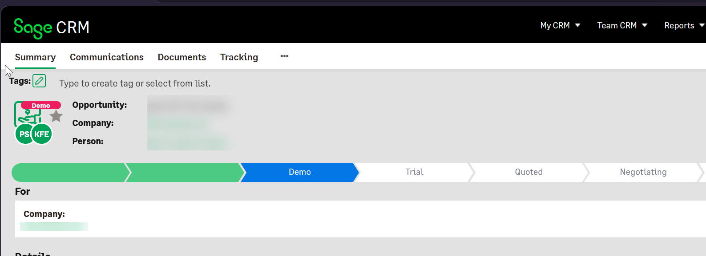
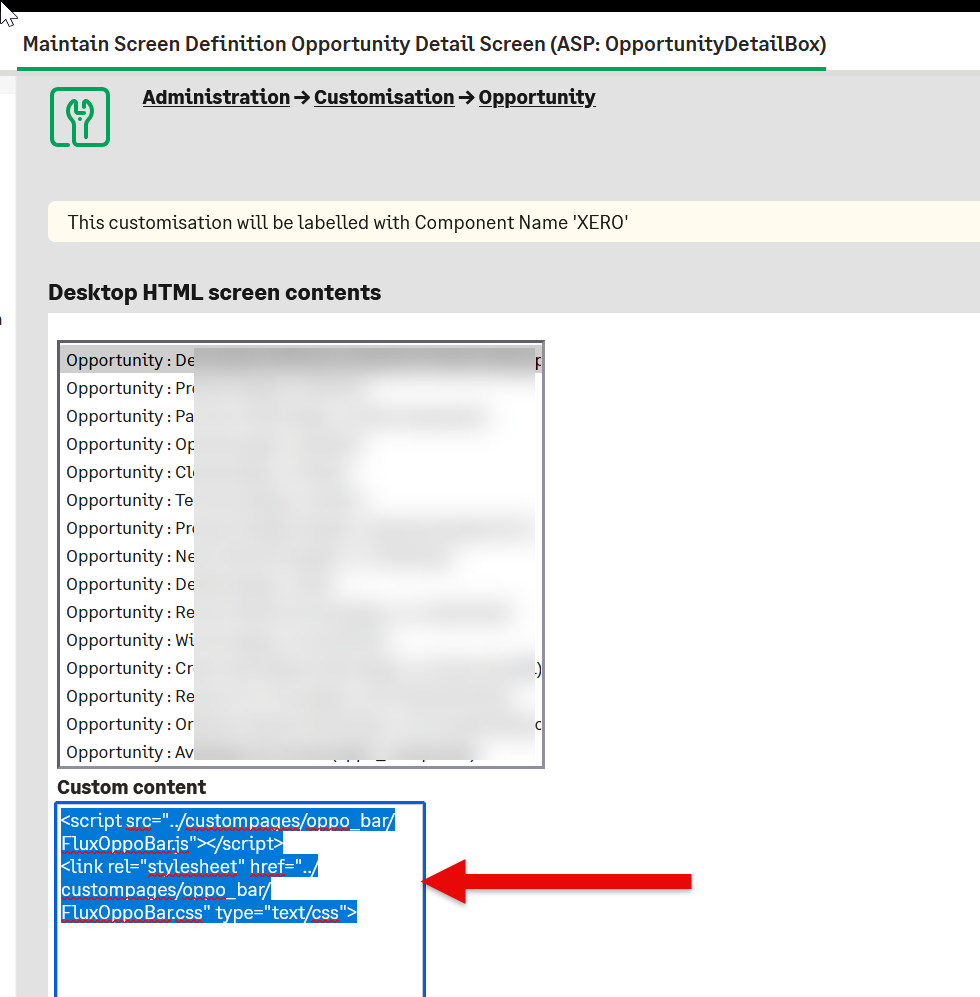

Examples of what you get

Install the Sage CRM component and then manually add in the script

  
  <link rel="stylesheet" href="../custompages/oppo_bar/FluxOppoBar.css" type="text/css">
  
to the Opportunity screen 

  OpportunityDetailBox
  
Custom Content 
section. 

--
Created by 

CRM Together - https://crmtogether.com

If you have any ideas for improvements or would like to contribute get in touch!

--
5 Oct 2026

First public release